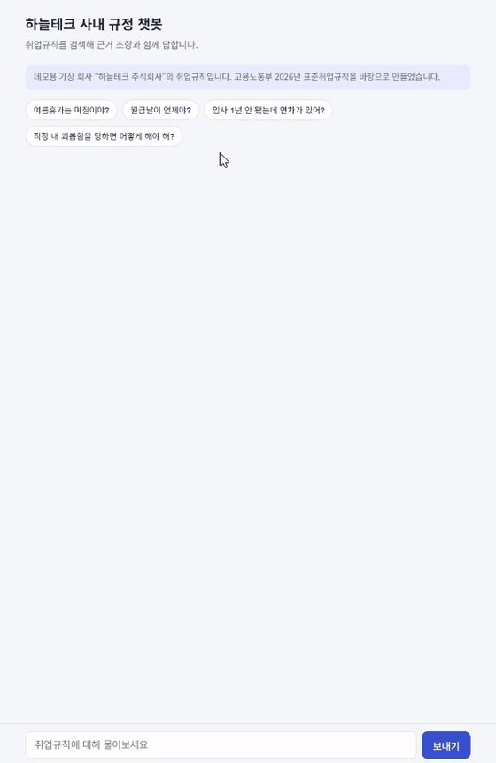

# 사내 규정 RAG 챗봇 (ChromaDB + Groq + Reranking)

> 회사 취업규칙을 근거로 직원 질문에 답하는 RAG(Retrieval-Augmented Generation) 챗봇입니다.
> 한글(.hwp) 규정 문서를 직접 읽어 조항 단위로 저장하고, Reranking으로 검색 품질을 높여 Groq의 LLM이 **근거 조항과 함께** 답변합니다.
> KorQuAD 기반 평가셋으로 검색 품질을 측정하며 개선하고 있고, FastAPI 서버와 채팅 화면으로 브라우저에서 바로 써 볼 수 있습니다.



*실제 속도 그대로 녹화했습니다 (내 PC, CPU). 답변 아래에 임베딩 검색 · 리랭킹 · 답변 생성 시간이 표시됩니다.*

---

## 프로젝트 소개

ChatGPT 같은 범용 LLM은 공개된 일반 지식에는 강하지만, 특정 회사의 내부 규정은 알지 못합니다.
이 프로젝트는 기업이 AI 전환(AX)에서 가장 흔하게 만드는 "사내 규정 비서"를 직접 구현해 본 것으로,
규정 문서를 검색해 그 조항을 근거로만 답하고, 답변마다 어느 조항을 근거로 했는지 밝힙니다.

데모 문서는 고용노동부가 공개한 **2026년 표준취업규칙**(일반 근로자용, 제1조~제98조)을 바탕으로 만든
**가상 회사 "하늘테크 주식회사"의 취업규칙**입니다. 표준취업규칙은 공개 문서라 범용 LLM도 이미 알고 있으므로,
실제 회사처럼 표준안의 빈칸(근무 시간, 점심시간, 월급날, 여름휴가 등 15곳)을 회사 고유의 값으로 채워
**외부에 공개되지 않은 사내 규정**과 같은 상황을 만들었습니다. 실제 회사가 아닌 데모용 가상 데이터입니다.

### 같은 질문, 범용 LLM과 비교

| 질문 | Gemini (2026-11-01) | 이 챗봇 |
|------|--------------------|--------|
| 하늘테크 주식회사 월급날이 언제야? | 정보를 찾을 수 없음 | 매월 25일, 휴일이면 전날 (근거: 제52조) |
| 하늘테크 주식회사 여름휴가는 며칠이야? | 정보를 찾을 수 없음 | 3일 (근거: 제37조) |
| 하늘테크 주식회사 창립기념일에도 쉬어? | 정보를 찾을 수 없음 | 4월 17일은 유급휴일 (근거: 제32조) |

Gemini는 지어내지 않고 "사내 규정 문서를 공유해 주면 안내하겠다"고 답했습니다. 하지만 실제 기업은 보안 때문에
내부 규정을 외부 AI 서비스에 올리기 어렵고, 질문할 때마다 문서를 건넬 수도 없습니다.
이 챗봇은 문서를 내부에 저장해 두고 질문과 관련된 조항만 찾아, 그 조항을 근거로 답합니다.

**문서 저장 흐름**
```
표준취업규칙(2026년, 배포).hwp
  → hwp_loader.py: HWP 5.0 파일을 직접 열어 본문 글자 추출 (olefile + zlib)
  → rules_parser.py: 일반 근로자용 본문만 골라 "제○조(제목)" 단위로 분리,
                     조항마다 붙은 담당자용 작성 해설([필수], ☞ 참고 …)은 제외
  → company_profile.json: 표준안의 빈칸(○○주식회사, 00:00 등)을 가상 회사 값으로 채움
  → 조항 1개 = 청크 1개 (800자를 넘는 조항만 문장 단위로 나눔) → 조항 99개, 청크 102개
  → 청크마다 "하늘테크 취업규칙 제33조(연차유급휴가)" 같은 조항 이름·장 정보를 메타데이터로 저장
```

**질문 응답 흐름**
```
사용자 질문
  → 임베딩 변환
  → ChromaDB에서 후보 7개 검색
  → Reranker(bge-reranker-v2-m3)로 재정렬 → 상위 3개 선별
  → 프롬프트 조합 (조항 이름을 붙인 컨텍스트 + 질문 + 근거 조항을 밝히라는 지시)
  → Groq API 호출 (openai/gpt-oss-120b)
  → 근거 조항과 함께 답변 출력
```

---

## 검색 품질 평가

RAG에서 답이 틀리면 원인이 검색인지 생성인지부터 나눠 봐야 하므로, LLM을 빼고 **검색 단계만** 따로 평가했습니다.

### 실험 1: 임베딩 모델과 리랭킹 (문단 300개)

**방법**
- 질문마다 정답 문단이 정해져 있는 [KorQuAD 1.0](https://huggingface.co/datasets/KorQuAD/squad_kor_v1) 검증 데이터에서 문단 300개와 질문 300개(문단당 1개)를 뽑아 사용
- 챗봇과 같은 청킹 함수(500자, 겹침 50자)로 문단을 잘라 ChromaDB에 저장
- 지표
  - **Hit@3**: 정답 문단이 상위 3개 안에 든 비율. 챗봇이 상위 3개 청크만 LLM에 넘기므로 핵심 지표
  - **Hit@10**: 후보 10개 안에 든 비율. 리랭커는 이 후보 안에서 순서만 바꾸므로 리랭킹의 상한선
  - **MRR**: 정답이 몇 번째로 나왔는지까지 반영 (1등 1점, 2등 0.5점, 3등 0.33점 …)

**결과** (Google Colab T4 GPU, 고정 길이 청킹)

| 실험 | 임베딩 모델 | 리랭킹 | Hit@1 | Hit@3 | Hit@10 | MRR | 질문당 시간 |
|------|------------|--------|-------|-------|--------|-----|------------|
| A | all-MiniLM-L6-v2 | X | 1.7% | 3.7% | 7.3% | 0.031 | 1.5ms |
| B | all-MiniLM-L6-v2 | O | 7.3% | 7.7% | 8.3% | 0.076 | 177ms |
| C | BAAI/bge-m3 | X | 95.3% | 98.3% | 100% | 0.971 | 6.9ms |
| D | BAAI/bge-m3 | O | 100% | 100% | 100% | 1.000 | 660ms |

**해석**
- 기존 영어 임베딩 모델(A)은 한국어 질문에서 정답 문단을 거의 찾지 못했습니다. 다국어 모델 bge-m3로 바꾸자 Hit@3가 3.7%에서 98.3%로 올라, 이 결과를 근거로 챗봇의 임베딩 모델을 교체했습니다.
- 영어 모델에 리랭킹을 붙여도(B) Hit@3가 7.7%에 그쳤습니다. 후보 10개 안에 정답이 든 경우(Hit@10)가 8% 남짓이라, 순서만 바꾸는 리랭킹으로는 해결할 수 없는 문제였습니다.
- bge-m3에 리랭킹을 더하면(D) Hit@3가 1.7%p 오르지만 질문당 시간이 약 100배 늘어납니다. 서비스에서는 이 비용을 감수할 가치가 있는지 판단이 필요합니다.

**한계**
- KorQuAD 질문은 문단을 보고 만들어 단어가 많이 겹치고 문단도 300개뿐이라, 실제 사용자 질문보다 쉬운 평가입니다. C·D가 거의 만점이라 이후 개선(청킹 등)의 차이를 보려면 더 어려운 평가가 필요합니다.
- 실험마다 색인을 새로 만들고 ChromaDB가 근사 검색(HNSW)을 써서, 같은 임베딩 모델이어도 후보가 조금씩 달라질 수 있습니다. A와 B의 Hit@10 차이(7.3% vs 8.3%, 3문항)는 이 때문으로 보입니다. → 이후 스크립트를 고쳐, 리랭킹 전후를 **한 번 검색한 같은 후보**로 비교하도록 했습니다.

### 실험 2: 청킹 방식 비교 (문단 960개)

실험 1이 거의 만점이라 차이가 보이지 않아, KorQuAD 검증 데이터의 문단 전체(960개)로 평가를 어렵게 한 뒤 청킹 방식을 비교했습니다.

**배경:** 실험 1의 실패 사례를 분석하니, 영어 모델에서는 고정 길이로 자르고 남은 짧은 꼬리 청크(예: "아니아 지역 한정으로 발매됐다.")가 수많은 질문의 1등을 차지했습니다. 틀린 질문 289개의 1등 청크가 51종류뿐이었고, 한 청크는 혼자 30번 1등이었습니다. 단어 중간("오세아니아" → "아니아")에서 잘린 청크도 많았습니다.

**문장 단위 청킹:** 문장 경계에서만 자르고, 앞 청크의 마지막 문장 1개를 겹치며, 100자 미만의 꼬리는 앞 청크에 합칩니다 (`ingest.py`의 `chunk_by_sentence`).

| 청킹 | 리랭킹 | Hit@1 | Hit@3 | Hit@10 | MRR | 청크 수 | 60자 미만 청크 | 질문당 시간 |
|------|--------|-------|-------|--------|-----|--------|---------------|------------|
| 고정 길이 | X | 84.5% | 94.2% | 97.8% | 0.897 | 1,558 | 155 | 6.7ms |
| 고정 길이 | O | 94.6% | 97.7% | 97.8% | 0.961 | 1,558 | 155 | 608ms |
| 문장 단위 | X | 84.6% | 94.6% | 98.0% | 0.899 | 1,359 | 0 | 6.9ms |
| 문장 단위 | O | 94.8% | 97.8% | 98.0% | 0.963 | 1,359 | 0 | 617ms |

(임베딩 bge-m3, Google Colab T4 GPU)

**해석**
- 문장 단위 청킹의 검색 점수 차이(Hit@3 +0.4%p, 960문항 중 4문항)는 오차 범위 안이라, **검색 성능이 좋아졌다고 보지 않습니다.** bge-m3는 짧은 청크도 잘 이해해 꼬리 청크 문제가 거의 없었고, KorQuAD 문단이 짧아(평균 청크 1~2개) 자르는 방식의 영향이 작았던 것으로 보입니다.
- 그래도 짧은 꼬리 청크가 155개에서 0개로 사라지고 청크 수가 13% 줄었으며, 문장 중간에서 잘리지 않아 LLM에 넘기는 문맥이 깔끔해집니다. 검색 성능 손해 없이 얻는 이점이라 챗봇에 적용했습니다.
- 평가가 어려워지자 리랭킹 효과가 분명히 보였습니다. Hit@1이 84.5%에서 94.6%로 약 10%p 올랐고, 리랭킹 전후 Hit@10이 같아 같은 후보로 순서만 바뀌었음을 확인했습니다. 대신 질문당 시간이 약 90배 늘어납니다.

```bash
pip install pandas pyarrow
python eval_retrieval.py                                  # A
python eval_retrieval.py --rerank                         # B
python eval_retrieval.py --embed BAAI/bge-m3              # C
python eval_retrieval.py --embed BAAI/bge-m3 --rerank     # D

# 실험 2 (--n-docs를 크게 주면 검증 데이터의 문단 전체를 사용)
python eval_retrieval.py --n-docs 5000 --embed BAAI/bge-m3 --chunker fixed --rerank
python eval_retrieval.py --n-docs 5000 --embed BAAI/bge-m3 --chunker sentence --rerank
```

> KorQuAD 데이터는 라이선스(CC BY-ND)에 따라 저장소에 포함하지 않으며, 스크립트 실행 시 내려받습니다.

---

## 답변 품질 평가 (하늘테크 취업규칙)

KorQuAD 질문은 문단을 보고 만들어 단어가 많이 겹치므로 실제 직원 질문보다 쉽다. 그래서 취업규칙에 대해 직원 말투로 쓴 질문으로
**검색부터 최종 답변까지** 다시 쟀다 (`eval_answers.py`).

| 평가셋 | 내용 |
|---|---|
| `data/domain_eval.json` | 규정에 답이 있는 질문 30개 ("월급 언제 들어와요?", "야근하면 수당 더 줘요?") + 규정에 없는 질문 7개 (재택근무, 반차, 식대 등) |
| `data/holdout_eval.json` | 개선을 마친 **뒤에** 김유나가 직접 쓴 질문 7개. 개선할 때 보지 않은 질문이라 과대평가를 확인하는 용도 |

| 지표 | 뜻 |
|---|---|
| 검색 Hit@3 | 정답 조항이 LLM에 넘기는 상위 3개 안에 들었는가 |
| 근거 인용률 | 답 끝에 정답 조항을 밝혔는가. **LLM이 실제로 받은 조항만** 인정한다 |
| 사실 정확도 | 답에 꼭 있어야 할 숫자·표현(예: 25일)이 들어 있는가 |
| 거절률 | 규정에 없는 질문(또는 질문의 일부)에 지어내지 않고 없다고 답했는가 |

### 결과

| | 검색 Hit@3 | 근거 인용 | 사실 정확도 | 거절 |
|---|---|---|---|---|
| 처음 (domain) | 28/30 | 28/30 | 29/30 | 7/7 |
| 검색 개선 후 (domain) | **30/30** | **30/30** | 29/30 * | 7/7 |
| 직접 쓴 질문 (holdout), 자동 채점 | 7/7 | 7/7 | 7/7 | 2/2 |
| 직접 쓴 질문, **답을 사람이 읽어 본 결과** | | | **5/7** | |

\* 틀린 1개(q04)는 "12 시부터 13 시까지"라고 맞게 답했는데 채점기가 `12:00`만 찾아 틀린 것으로 셌다. 결과를 본 뒤 `12:00|12시`처럼 다른 표기를 허용하도록 채점기를 고쳤으므로, 표에는 고치기 전 숫자를 그대로 둔다.

### 처음 평가에서 찾은 문제와 수정

| 질문 | 문제 | 원인 | 수정 |
|---|---|---|---|
| q09 "아직 입사 1년 안 됐는데 휴가 쓸 수 있어?" | 정답 제33조가 상위 3개에서 빠짐 | 긴 제35조가 청크 2개로 나뉘어 상위 3자리 중 2자리를 차지 | 리랭킹 뒤 **조항당 청크 1개**만 남김 |
| q21 "야근하면 수당 더 줘요?" | 제29조를 못 찾고, 답에 "20%"를 지어냄 | 직원은 "야근", 규정은 "연장근로·야간근로" | 질문에 규정 용어를 덧붙이는 **용어 사전** (`TERM_DICT`, 검색에만 사용) |
| q21 채점 | 못 찾은 제29조가 '인용 O'로 채점됨 | 제51조 본문의 "제29조에 따라"를 LLM이 옮겨 적음 | 인용은 LLM이 실제로 받은 조항일 때만 인정 |

용어 사전은 평가셋에서 틀린 질문을 보고 만들었기 때문에 domain 점수가 오르는 건 당연하다. 그래서 개선 뒤에 직접 쓴 질문(holdout)으로 따로 확인했다.
holdout 중 h05 "야근할때 야근 수당 나와?"는 사전에 있는 단어를 써서 완전히 처음 보는 질문은 아니다.

### 자동 채점 100%였지만 답을 읽어 보니 2개가 틀렸다

| 질문 | 실제 답 | 자동 채점이 놓친 이유 |
|---|---|---|
| h03 "자꾸 상사가 짬때리면 어떻게 해야해?" | '짬때리다'(일을 떠넘기다)를 **폭행**으로 이해하고 폭행 대응을 안내 | 괴롭힘 조항(제75조)은 맞게 찾아 조항 번호만 보는 채점은 통과 |
| h07 "성과금같은건 얼마나 받고, 어떤 기준으로 주니?" | 규정에 없는 성과금을 "성과금(상여금)"이라 부르며 상여금을 설명 | 답의 다른 부분에 "명시되어 있지 않"이 있어 거절로 셈 |

자동 지표는 조항 번호와 글자만 보므로 **질문 뜻을 잘못 이해한 답**은 잡지 못한다. 그래서 숫자와 함께 답을 직접 읽어 확인한다.

두 문제에 맞춰 특정 단어를 사전에 넣는 대신, 어떤 질문에도 적용되는 규칙을 프롬프트에 넣었다.

- 질문의 제도·용어가 문서에 없으면, 비슷한 제도를 설명하기 전에 없다고 먼저 밝히고 문서의 이름 그대로 부른다
- 은어·줄임말의 뜻이 확실하지 않으면 어떻게 이해했는지 먼저 밝힌다

| 질문 | 프롬프트 수정 후 |
|---|---|
| h07 | **해결.** "문서에 '성과금'이라는 용어는 없으며, 가장 가까운 제도는 '상여금'"으로 시작하고, 성과 평가 기준은 문서에 없다고 답함 |
| h03 | **여전히 틀림.** 이해한 뜻을 밝히기는 했지만("신체적으로 폭행('짬때리다')") 뜻 자체를 잘못 알고 있다. 모델이 모르는 은어는 프롬프트로 고칠 수 없고, 단어를 사전에 넣으면 이 질문에 맞춘 과적합이 되므로 한계로 남긴다 |

프롬프트 수정 뒤 전체 평가셋 재측정은 Groq 무료 요청 한도 때문에 아직 h03·h07만 돌렸다.

```bash
python eval_answers.py --retrieval-only            # LLM 없이 검색만 (API 키 불필요)
python eval_answers.py --sleep 2                   # domain 전체. 요청 한도에 걸리면 안내된 시간만큼 기다렸다 다시 시도
python eval_answers.py --set holdout --sleep 2     # 직접 쓴 질문
python eval_answers.py --set holdout --ids h03,h07 # 일부 질문만
```

---

## API 서버와 응답 속도 개선

`api.py`는 챗봇을 FastAPI 서버로 제공합니다. 같은 서버가 채팅 화면(`static/index.html`)도 보여 줍니다.

| 엔드포인트 | 설명 |
|-----------|------|
| `GET /` | 채팅 화면 (답변, 근거 조항, 단계별 걸린 시간 표시) |
| `GET /health` | 서버 상태와 저장된 청크 수 |
| `POST /ask` | `{"question": "..."}` → 답변, 근거 조항(리랭크 점수 포함), 단계별 시간(ms) |
| `GET /docs` | FastAPI가 자동으로 만드는 API 문서와 테스트 화면 |

- 질문은 1~500자만 받고, 빈 질문은 422로 거절합니다. API 키가 없으면 503, LLM 호출이 실패하면(모델 지원 종료, 한도 초과 등) 502를 돌려줍니다.
- 로그에는 질문 내용 대신 글자 수와 근거 조항, 단계별 시간만 남깁니다.
- `tests/test_api.py`는 무거운 모델과 Groq 호출을 가짜로 바꿔 API 동작(정상 응답, 입력 검증, 오류 코드)만 빠르게 확인합니다.
- `Dockerfile`과 `deploy_space.py`로 Hugging Face Spaces(Docker)에 올릴 수 있게 준비했습니다. 빌드할 때 DB를 만들고 모델을 미리 내려받아,
  서버가 켜질 때 기다리는 시간을 줄입니다. 다만 2026년 하반기부터 Hugging Face가 새 계정의 무료 CPU 사용을 막고 있어
  (`You've reached your cpu-basic quota limit`), 지금은 공개 링크 대신 위의 데모 영상으로 대신합니다.

### 1. 모델을 한 번만 불러오기

CLI 버전은 질문할 때마다 bge-m3(약 2GB)를 새로 불러왔습니다. 서버에서는 `lru_cache`로 임베딩 모델, 리랭커, Groq 클라이언트를
처음 한 번만 만들고, 서버가 켜질 때(`lifespan`) 미리 불러 두어 첫 질문부터 바로 답하게 했습니다.

### 2. 어디서 느린지 나눠 재기

응답마다 단계별 시간을 따로 재 보니, 느린 곳은 리랭킹 한 곳이었습니다. (내 PC, CPU 6스레드, 후보 10개)

| 단계 | 시간 |
|------|------|
| 임베딩 검색 (bge-m3 + ChromaDB) | 약 0.1초 |
| **리랭킹 (bge-reranker-v2-m3)** | **약 9초** |
| 답변 생성 (Groq) | 약 1~2초 |

리랭커는 (질문, 조항) 쌍을 하나씩 끝까지 읽기 때문에, 읽을 **후보 수**와 쌍마다 읽는 **길이(토큰)**에 비례해 느려집니다.

### 3. 후보 수와 길이를 바꿔 측정 (`bench_rerank.py`)

직원 질문 12개로, 지금 설정(후보 10개, 길이 제한 없음)을 기준으로 삼아 비교했습니다.
- top1 일치: 1등 청크가 기준과 같은 질문 수
- top3 겹침: LLM에 실제로 넘어가는 상위 3개 청크가 기준과 겹치는 비율

| 후보 수 | 최대 길이 | 리랭킹 평균 | top1 일치 | top3 겹침 |
|--------|----------|------------|----------|----------|
| 10 | 제한 없음 (기준) | 8,129ms | 12/12 | 100% |
| 10 | 256토큰 | 5,057ms | 10/12 | 100% |
| **7** | **제한 없음** | **5,681ms** | **12/12** | **97%** |
| 5 | 제한 없음 | 3,992ms | 12/12 | 89% |
| 5 | 256토큰 | 2,549ms | 11/12 | 89% |

(질문·조항 쌍은 평균 253토큰, 최대 462토큰이라 512토큰 제한은 '제한 없음'과 같아 표에서 뺐습니다.)

**해석과 선택: 후보 7개**
- 길이를 256토큰으로 자르면 쌍의 44%(120개 중 53개)가 잘리고, 2개 질문에서 1등이 바뀌었습니다. 조항 뒷부분에 답이 있는 경우가 있어 자르지 않기로 했습니다.
- 후보를 5개로 줄이면 가장 빠르지만, "직장 내 괴롭힘" 질문에서 실제 근거인 **제80조(피해사원등의 보호)**가 빠졌습니다.
  bge-m3는 이 조항을 6~7등으로 찾았고, 리랭커가 3등으로 끌어올리던 조항입니다. 리랭킹이 필요한 이유를 보여 주는 사례이기도 합니다.
- 후보 7개는 리랭킹 시간을 **30% 줄이면서**(8.1초 → 5.7초) 1등이 모두 같았고, 상위 3개에서 빠진 것은 질문과 관계없는 조항 1개(수습 질문의 제17조 휴직)뿐이었습니다.

> 측정 중 실수도 있었습니다. 처음에는 조항 이름으로 결과를 비교했는데, 긴 조항은 청크 2개로 나뉘어 이름이 같아 기준이 자기 자신과도 97%로 나왔습니다.
> 또 최신 sentence-transformers는 길이 제한을 바꾸면 토크나이저 기본값도 함께 바뀌어, 256 다음에 잰 '제한 없음'이 실제로는 256으로 측정됐습니다.
> 두 문제를 고친 뒤(청크 본문으로 비교, 원래 길이로 되돌리기) 다시 측정한 결과가 위 표입니다.

---

## 보안: 사내 문서가 어디까지 나가는가

임베딩 모델, 벡터 DB, 리랭커는 모두 서버 안에서 돈다. **밖으로 나가는 곳은 답변을 만들 때 외부 LLM(Groq)을 부르는 한 곳뿐**이고, 이때 질문과 검색된 조항 3개가 전송된다. 여기에 맞춰 세 가지를 두었다 (`security.py`).

| 위험 | 대응 |
|---|---|
| 직원이 아닌 사람이 질문 | 로그인하면 JWT(30분 유효)를 발급하고, `/ask`는 토큰의 서명과 만료를 검사한다. 토큰이 없거나 위조·만료되면 401 |
| 일부 부서만 봐야 하는 문서가 다른 부서에 노출 | 문서마다 열람 권한을 메타데이터(`access`)로 붙이고, **검색 단계에서** 사용자 권한으로 걸러 낸다. 권한 없는 조항은 리랭커와 LLM까지 가지 않는다. 권한은 요청 본문이 아니라 서명된 토큰의 부서에서 꺼낸다 |
| 권한을 깜빡 안 붙인 문서 | 등록되지 않은 문서는 `비공개`로 저장되어 아무도 검색할 수 없다 (기본 거부) |
| 질문 속 개인정보가 외부 LLM으로 전송 | 주민번호·전화번호·이메일을 LLM에 보내기 전에 `[전화번호]`처럼 가린다. 검색은 서버 안에서 원문으로 한다 |

LLM에게 "인사 문서는 보여 주지 마"라고 지시하는 방식은 프롬프트를 조작하면 뚫릴 수 있어서, 애초에 검색 결과에서 빼는 방식을 택했다.

취업규칙은 근로기준법 제14조에 따라 근로자가 자유롭게 열람할 수 있어야 하는 문서라 `전체`로 둔다. 권한 구조는 인사 내부 지침처럼 일부 부서만 봐야 하는 문서를 넣을 때 쓰이며, `tests/test_security.py`가 가짜 문서로 "개발팀은 인사팀 전용 문서를 찾지 못한다"를 확인한다.

남은 한계도 있다. 질문과 조항 3개는 여전히 외부 LLM으로 나가므로, 실제 회사라면 사내에 설치한 모델이나 입력을 학습에 쓰지 않는다고 계약된 API를 써야 한다. 데모 계정은 코드에 해시로 들어 있고, 실제로는 사내 계정 시스템(SSO)과 연결해야 한다.

---

## 파일 구조

```
rag_chatbot/
├── ingest.py          # docs 폴더 문서를 청킹해 저장 / 삭제 / 조회
├── hwp_loader.py      # 한글(.hwp) 문서 본문 추출
├── rules_parser.py    # 규정 문서를 조항 단위로 분리, 작성 해설 제외, 회사 설정 적용
├── company_profile.json # 가상 회사(하늘테크) 설정: 표준안 빈칸을 채울 값
├── data/haneul_rules.json # 조항 가공본 (원본 HWP 없이 DB를 만들 때·배포할 때 사용)
├── chatbot.py         # RAG 파이프라인 + 대화형 CLI
├── api.py             # FastAPI 서버 (/login, /ask, /health, 채팅 화면)
├── security.py        # 로그인(JWT), 문서 열람 권한, 민감정보 가리기
├── static/index.html  # 브라우저용 채팅 화면
├── tests/test_api.py  # API 테스트: 응답, 오류 코드, 로그인·토큰 위조·만료 (pytest)
├── tests/test_security.py # 열람 권한 필터, 기본 거부, 민감정보 가리기, 용어 사전, 조항 중복 제거
├── tests/test_eval_answers.py # 답변 평가 채점 규칙
├── eval_answers.py    # 답변 품질 평가 (검색 Hit@3, 근거 인용, 사실 정확도, 거절률)
├── data/domain_eval.json  # 직원 말투 질문 37개와 정답 조항
├── data/holdout_eval.json # 개선 뒤에 직접 쓴 질문 (과대평가 확인용)
├── eval_retrieval.py  # 검색 품질 평가 (KorQuAD 기반 Hit@k, MRR)
├── bench_rerank.py    # 리랭킹 후보 수·길이별 속도와 결과 비교
├── Dockerfile         # 배포용 컨테이너 설정 (Hugging Face Spaces)
├── deploy_space.py    # Spaces에 배포할 파일만 골라 올리기
├── space/README.md    # Space 설정과 소개
├── requirements.txt   # 필요한 패키지
├── README.md          # 프로젝트 설명
├── docs/              # 넣을 문서 (.hwp / .txt) — 원본은 저장소에 포함하지 않음
└── chroma_db/         # ChromaDB 로컬 저장소 (자동 생성)
```

---

## 설치

```bash
pip install -r requirements.txt
```

---

## 사용 방법

### 1단계 — Groq API 키 설정

[https://console.groq.com](https://console.groq.com) 에서 무료 가입 후 API 키 발급

```bash
# Windows
set GROQ_API_KEY=gsk_여기에키입력

# Mac/Linux
export GROQ_API_KEY=gsk_여기에키입력
```

로그인 토큰을 서명할 비밀키도 설정합니다. 충분히 긴 임의 문자열이면 됩니다.

```bash
# Windows (PowerShell)
$env:JWT_SECRET = "여기에-32자-이상-임의-문자열"
```

### 2단계 — 문서 준비 및 추가

> 원본 HWP가 없어도 됩니다. `docs`에 .hwp가 없으면 `python ingest.py`가 저장소에 포함된 가공본(`data/haneul_rules.json`)으로 같은 DB(조항 99개, 청크 102개)를 만듭니다.
> 원본 파일은 고용노동부 배포 파일이라 저장소와 배포 서버에 올리지 않고, 가상 회사 값으로 채운 조항 텍스트만 올렸습니다.
> 원본으로 가공본을 다시 만들려면 아래 1~2를 한 뒤 `python ingest.py --export`를 실행합니다.

1. 고용노동부 [2026년 표준 취업규칙 게시글](https://www.moel.go.kr/policy/policydata/view.do?bbs_seq=20260200740)에서 `표준취업규칙(2026년, 배포).hwp`를 내려받습니다.
2. 프로젝트 안에 `docs` 폴더를 만들고 파일을 넣습니다.
3. 문서를 저장합니다. (`docs` 폴더의 .hwp는 규정 문서로, .txt는 일반 문서로 처리)
   `company_profile.json`이 있으면 빈칸을 그 값으로 채웁니다. 값을 바꾸려면 이 파일의 `replace` 문장만 고치면 됩니다.

```bash
python ingest.py
# [안내] 회사 설정 적용: 하늘테크 주식회사 (15개 문장 교체)
# [추가 완료] '하늘테크 취업규칙' → 조항 99개, 102개 청크 저장
```

### 3단계 — 챗봇 실행

**웹 화면 (FastAPI 서버)**

```bash
uvicorn api:app --reload
# 브라우저에서 http://127.0.0.1:8000 (채팅 화면), http://127.0.0.1:8000/docs (API 문서)
```

채팅 화면에서 데모 계정으로 로그인한 뒤 질문합니다. `employee` / `demo1234` (개발팀), `hr` / `demo1234` (인사팀).
API 문서 화면에서는 `/login`으로 받은 토큰을 오른쪽 위 **Authorize**에 넣으면 `/ask`를 시험할 수 있습니다.

> 열람 권한 기능을 넣은 뒤에는 `python ingest.py`로 DB를 다시 만들어야 합니다. 예전 DB의 조항에는 권한 꼬리표가 없어서 기본 거부로 검색되지 않습니다.

**터미널 (CLI)**

```bash
python chatbot.py
```

```
질문: 여름휴가는 며칠이야?

── 검색된 청크 (reranking 적용) ──
  1. [하늘테크 취업규칙 제37조(하기휴가)] rerank 점수: 0.3166
  2. [하늘테크 취업규칙 제23조(근로시간)] rerank 점수: 0.0133
  3. [하늘테크 취업규칙 제33조(연차유급휴가)] rerank 점수: 0.0061

답변:
여름휴가는 3일입니다.
근거: 하늘테크 취업규칙 제37조(하기휴가)
```

```
질문: 직장 내 괴롭힘을 당하면 어떻게 해야 해?

── 검색된 청크 (reranking 적용) ──
  1. [하늘테크 취업규칙 제81조(직장 내 괴롭힘 사실의 확인 및 조치)] rerank 점수: 0.9893
  2. [하늘테크 취업규칙 제78조(사건의 접수)] rerank 점수: 0.9309
  3. [하늘테크 취업규칙 제80조(피해사원등의 보호)] rerank 점수: 0.9183

답변:
1. 신고·접수: 괴롭힘 사실을 알게 되면 사용자 또는 예방·대응 담당자에게 신고합니다. (근거: 제78조)
2. 조사 및 보호: 조사 기간 동안 피해 사원을 보호하기 위한 조치를 취합니다. (근거: 제80조)
3. 조사 결과에 따른 조치: 괴롭힘이 인정되면 지체 없이 행위자에 대해 징계 등 필요한 조치를 합니다. (근거: 제81조)
…
```

> 빈칸 중 탄력적 근로시간제(제25조)처럼 채우지 않은 부분은 `00`으로 남아 있습니다. 챗봇은 이런 부분을 지어내지 않고 "회사가 정해야 하는 부분"이라고 안내하도록 지시받습니다.

### 테스트

```bash
pip install pytest httpx
python -m pytest
```

### 문서 관리

```python
from ingest import list_documents, delete_document, delete_all

list_documents()            # 저장된 문서 목록 확인
delete_document("문서이름")  # 특정 문서 삭제
delete_all()                # 전체 삭제 (주의)
```

---

## 커스터마이징

| 파일 | 변수 | 설명 | 기본값 |
|------|------|------|--------|
| `ingest.py` | `CHUNK_SIZE` | 청크 크기 | 500자 |
| `ingest.py` | `CHUNK_OVERLAP` | 청크 겹침 (fixed 방식) | 50자 |
| `ingest.py` | `CHUNK_METHOD` | 청킹 방식 (`fixed` / `sentence`) | sentence |
| `ingest.py` | `DOCS_DIR` | 넣을 문서 폴더 | ./docs |
| `ingest.py` | `ARTICLE_MAX_LEN` | 조항이 이보다 길면 문장 단위로 나눔 | 800자 |
| `ingest.py` | `MIN_CHUNK_LEN` | 이보다 짧은 꼬리는 앞 청크에 합침 (sentence 방식) | 100자 |
| `ingest.py`, `chatbot.py` | `EMBED_MODEL` | 임베딩 모델 (두 파일이 같아야 함) | BAAI/bge-m3 |
| `chatbot.py` | `CANDIDATE_K` | 임베딩 검색 후보 수 (리랭킹 대상) | 7 |
| `chatbot.py` | `TOP_K` | LLM에 전달할 최종 청크 수 | 3 |
| `chatbot.py` | `RERANK_MODEL` | 리랭킹 모델 | bge-reranker-v2-m3 |
| `chatbot.py` | `GROQ_MODEL` | LLM 모델 | openai/gpt-oss-120b |

---

## 기술 스택

| 역할 | 라이브러리 |
|------|-----------|
| 벡터 DB | ChromaDB |
| 임베딩 모델 | SentenceTransformers (BAAI/bge-m3) |
| 리랭킹 모델 | BAAI/bge-reranker-v2-m3 |
| LLM | Groq (openai/gpt-oss-120b) |
| API 서버 | FastAPI, Uvicorn, Pydantic |
| 인증 | JWT (PyJWT), PBKDF2 비밀번호 해시 |
| 테스트 | pytest |
| 언어 | Python 3.10+ |

---

## 외부 LLM API 변화 대응

### Gemini API 한계 및 Groq 전환

개발 초기 Gemini API를 사용했으나 아래 문제로 Groq으로 전환했습니다.

| 문제 | 내용 |
|------|------|
| 한국 지역 제한 | 무료 티어 limit: 0 으로 설정되는 문제 발생 |
| 일일 요청 한도 | 429 RESOURCE_EXHAUSTED 오류 반복 |
| 분당 요청 한도 | 짧은 시간 내 여러 요청 시 차단 |

```
오류 예시:
429 RESOURCE_EXHAUSTED
* Quota exceeded for metric: generate_content_free_tier_requests, limit: 0
```

**Groq 선택 이유:** 한국에서 정상 작동, 넉넉한 무료 티어

### Groq 모델 지원 종료 대응

Groq가 `llama-3.3-70b-versatile`을 2026년 8월 16일에 지원 종료하면서 `404 model_not_found` 오류가 발생했습니다.
모델 이름을 `chatbot.py`의 `GROQ_MODEL` 한 곳에서만 관리하고 있어, Groq가 권장하는 대체 모델 `openai/gpt-oss-120b`로 한 줄만 바꿔 대응했습니다.
([Groq Deprecations](https://console.groq.com/docs/deprecations))

---

## 개선 가능한 점

> ✅ 완료: 한국어 임베딩 모델 교체 (all-MiniLM-L6-v2 → bge-m3), 문장 단위 청킹 적용 (결과는 [검색 품질 평가](#검색-품질-평가) 참고),
> FastAPI 서버와 웹 채팅 화면, 리랭킹 후보 수 조정으로 응답 시간 단축 (결과는 [API 서버와 응답 속도 개선](#api-서버와-응답-속도-개선) 참고),
> 직원 말투 평가셋으로 답변 품질 평가 (결과는 [답변 품질 평가](#답변-품질-평가-하늘테크-취업규칙) 참고)

### 1. 멀티턴 대화 히스토리 유지

현재는 매 질문이 독립적으로 처리되어 이전 대화 내용을 기억하지 못합니다.

```python
# chatbot.py 개선안
chat_history = []  # 대화 히스토리 저장

def ask_groq(prompt: str) -> str:
    chat_history.append({"role": "user", "content": prompt})

    response = client.chat.completions.create(
        model=GROQ_MODEL,
        messages=chat_history  # 전체 히스토리 전달
    )

    answer = response.choices[0].message.content
    chat_history.append({"role": "assistant", "content": answer})
    return answer
```

### 2. 평소 말과 규정 용어의 차이 줄이기
용어 사전(`TERM_DICT`)으로 "야근 → 연장근로", "보너스 → 상여금"처럼 질문에 규정 용어를 덧붙여 검색하고 있다 ([답변 품질 평가](#답변-품질-평가-하늘테크-취업규칙)).
사전은 사람이 손으로 채워야 하고 "짬때리다" 같은 은어는 계속 새로 생기므로, LLM이 질문을 규정 용어로 바꿔 검색하는 단계를 비교해 볼 계획이다.

### 3. 리랭킹 비용 더 줄이기
후보 수를 7개로 줄여 리랭킹 시간을 30% 줄였지만, CPU에서는 여전히 5초 이상 걸립니다.
리랭커를 ONNX로 바꾸고 양자화하거나, 더 가벼운 한국어 리랭커와 정확도를 비교해 볼 계획입니다.

### 4. 평가 고도화
- 직원 말투 평가셋과 답변 평가는 만들었다. 질문 수(37 + 7)가 적어 1문제가 3%p라 더 늘려야 한다
- 실제 직원 질문 로그가 있다면 그걸로 평가셋을 만드는 것이 가장 정확하다
- 질문 뜻을 오해한 답(h03)은 자동 지표로 못 잡으므로, 사람 검토를 줄일 방법(LLM 채점 등)과 그 신뢰도를 비교해 보고 싶다

### 5. 기타
- PDF, DOCX 등 다양한 파일 형식 지원

---

## 라이선스

MIT License
